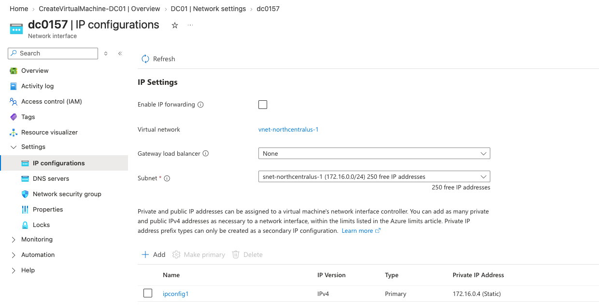
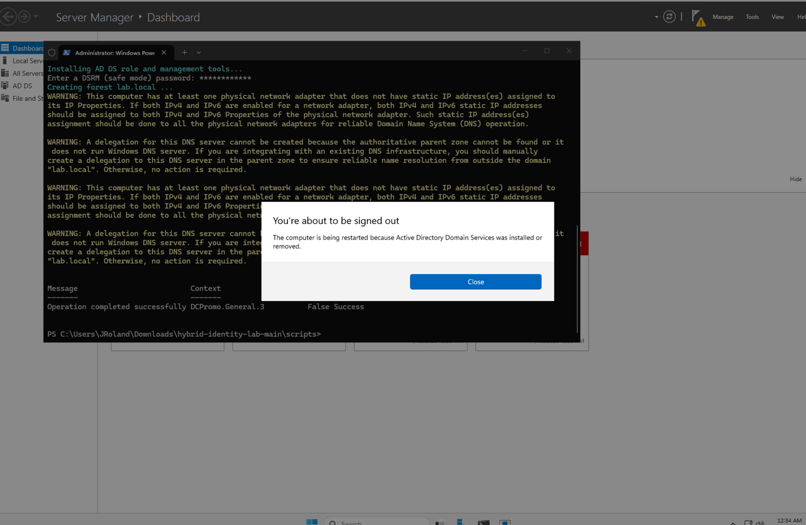
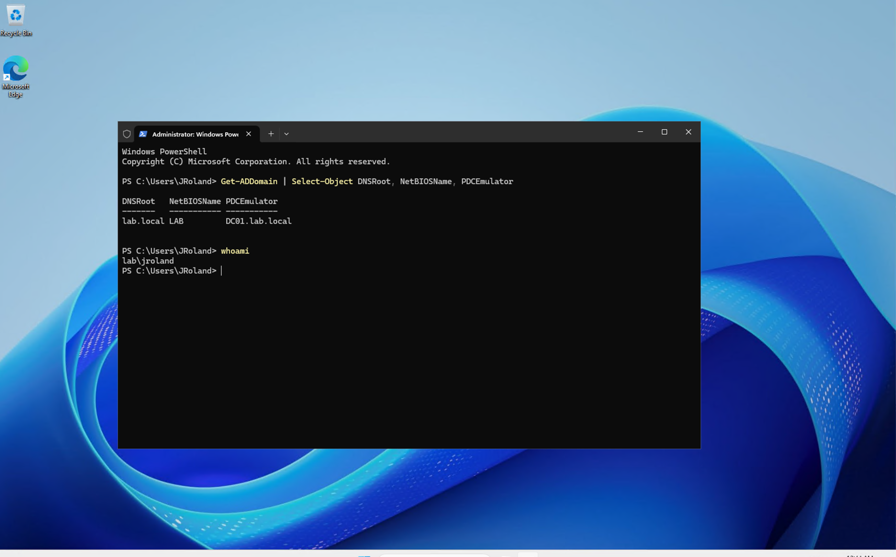
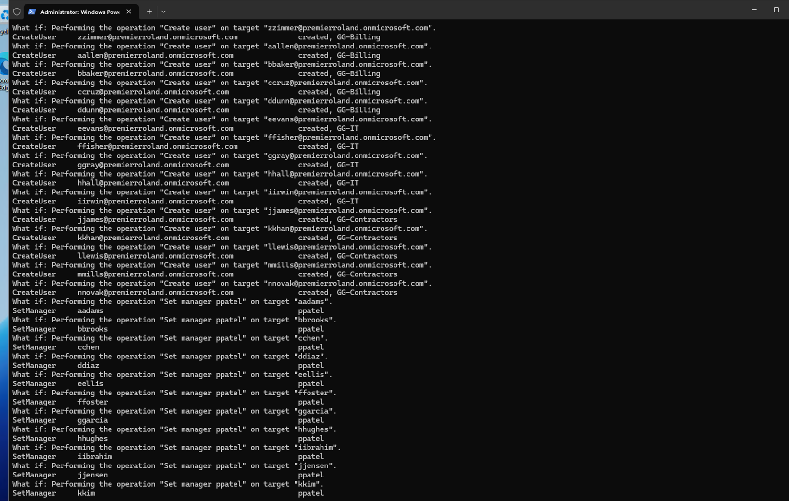
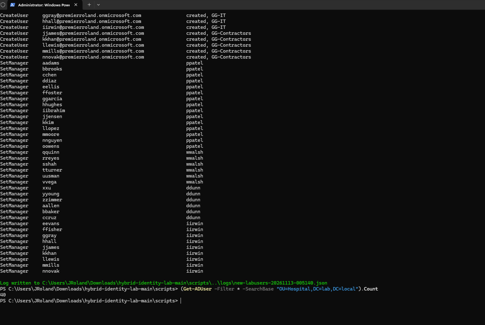
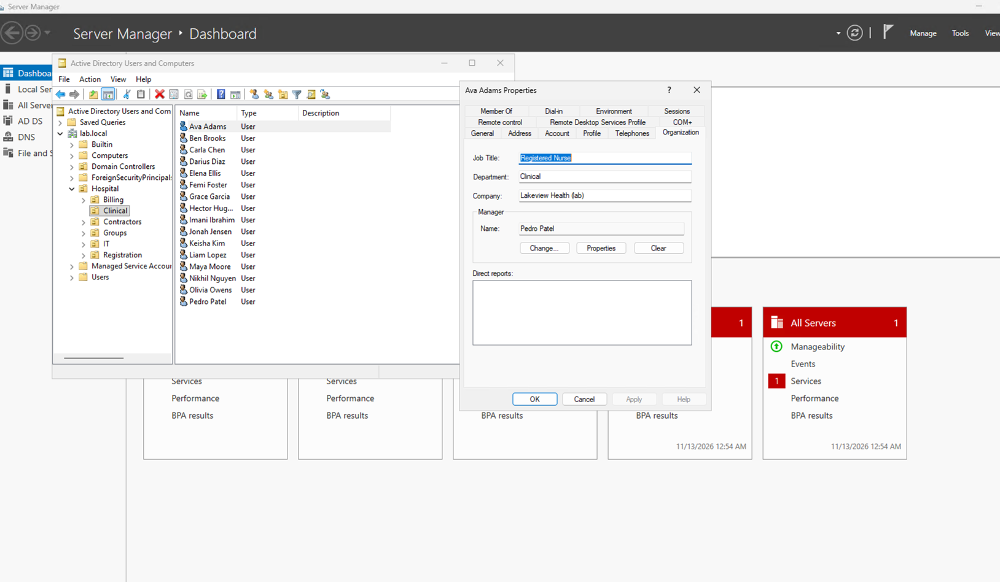

# Active Directory Lab: a domain controller in Azure, built with PowerShell

> **Loom walkthrough (5 min):** _link coming soon_

Lab 1 of 5. I built a Windows Server 2025 domain controller in Azure for a mock hospital ("Lakeview Health"), then created its directory (OUs, security groups and 40 users with managers) from an HR style CSV using a PowerShell script with a dry run mode. All names and data are fake.

## What this proves

| Skill | Evidence |
| --- | --- |
| Active Directory administration | New forest `lab.local`, OU design, global security groups, manager relationships |
| PowerShell automation | `New-LabUsers.ps1` builds 6 OUs, 5 groups and 40 users from a CSV |
| Safe change habits | `-WhatIf` dry run before every real run, JSON run log, no passwords in code |
| Cloud infrastructure basics | Azure VM, static private IP, NSG locked to my IP, VNet DNS, auto shutdown |

## Architecture

```
Azure (North Central US), resource group rg-iam-lab
└── VNet 172.16.0.0/24, DNS -> 172.16.0.4
    └── DC01  Windows Server 2025, Standard D2as v5
        ├── AD DS + DNS, forest lab.local (NetBIOS LAB)
        ├── Private IP 172.16.0.4 (static)
        ├── RDP allowed from my IP only
        └── Auto shutdown 11 PM
```

## Directory design

```
lab.local
└── OU=Hospital
    ├── OU=Clinical       nurses, physicians, nurse manager
    ├── OU=Registration
    ├── OU=Billing
    ├── OU=IT
    ├── OU=Contractors
    └── OU=Groups         GG-Clinical, GG-Registration, GG-Billing, GG-IT, GG-Contractors
```

## How I built it

1. **Created the VM.** Windows Server 2025 Datacenter, static private IP, RDP rule set to my IP only, auto shutdown to save credit.
   
2. **Promoted it to a domain controller** with [`Install-LabDomainController.ps1`](scripts/Install-LabDomainController.ps1). The DSRM password is typed at runtime, never stored.
   
3. **Pointed the VNet's DNS at DC01** and restarted, so anything joining the domain can find it.
4. **Signed in as a domain account** and confirmed the domain.
   
5. **Previewed the directory build** with `-WhatIf`. Nothing is created; every planned change is printed.
   
6. **Ran it for real** and verified: 40 users, attributes, managers and group membership.
   
   

## Run it yourself

```powershell
# On the VM, in an elevated PowerShell window
Set-ExecutionPolicy -Scope Process Bypass
.\scripts\Install-LabDomainController.ps1 -DomainName lab.local -NetbiosName LAB
# after the reboot, signed in as LAB\<admin>
.\scripts\New-LabUsers.ps1 -UpnSuffix <yourtenant>.onmicrosoft.com -WhatIf
.\scripts\New-LabUsers.ps1 -UpnSuffix <yourtenant>.onmicrosoft.com
```

The UPN suffix is the Entra tenant domain so users can sign in to the cloud once synced in [Lab 2](https://github.com/jasonroland-tech/hybrid-identity-lab).

## Lessons learned

- **The cheapest VM sizes are not offered on Azure free subscriptions.** B2s and D2s v3 returned `NotAvailableForSubscription`; D2as v5 worked.
- **Use the subnet's real range.** I tried `10.0.0.4` but the subnet was `172.16.0.0/24`. Read the network before assigning addresses.
- **Dry runs should still log.** My first `-WhatIf` run printed "log written" but skipped the file, because `-WhatIf` also applied to the log writes. Fixed with `-WhatIf:$false` on those two lines.

See [docs/build-log.md](docs/build-log.md) and the [command cheat sheet](docs/cheatsheet.md).

## Lakeview Health identity lab series

A mock hospital built step by step. Each lab is its own repo with a short Loom walkthrough.

| # | Lab | Focus |
| --- | --- | --- |
| 1 | **active-directory-lab** (this repo) | Active Directory domain in Azure |
| 2 | [hybrid-identity-lab](https://github.com/jasonroland-tech/hybrid-identity-lab) | AD to Entra ID with Cloud Sync |
| 3 | [identity-lifecycle-jml-lab](https://github.com/jasonroland-tech/identity-lifecycle-jml-lab) | Joiner, mover, leaver automation |
| 4 | [entra-conditional-access-lab](https://github.com/jasonroland-tech/entra-conditional-access-lab) | Conditional Access and break glass |
| 5 | [entra-saml-sso-lab](https://github.com/jasonroland-tech/entra-saml-sso-lab) | SAML single sign on |
